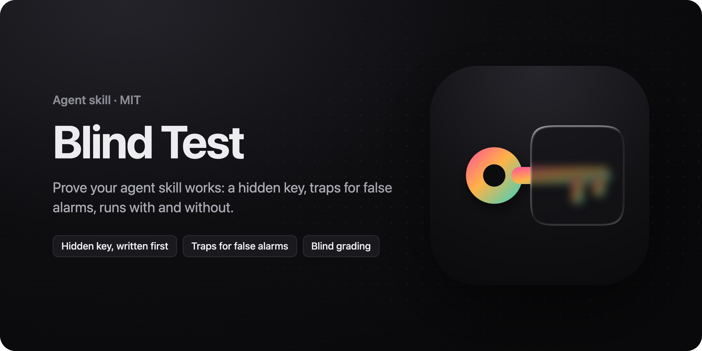
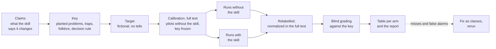

<p align="center">
  
</p>

<h1 align="center">Blind Test</h1>

<h3 align="center">Does your skill, harness or MCP server actually help? Prove it.</h3>

<p align="center">
  An agent skill for blind tests of anything that changes what an agent does: skills, prompts, rule files, MCP servers, agent harnesses.<br />
  A fictional target, a hidden key written first, traps for false alarms, and runs with and without the change.
</p>

<p align="center">
  <a href="#install"></a>
  <a href="#install"></a>
  <a href="#install"></a>
  <a href="#install"></a>
  <a href="skills/blind-test/scripts"></a>
  <a href="https://github.com/arez-xd/blind-test/actions/workflows/ci.yml"></a>
  <a href="CHANGELOG.md"></a>
  <a href="LICENSE"></a>
</p>

<p align="center">
  <a href="#quick-start">Quick start</a> ·
  <a href="#how-it-works">How it works</a> ·
  <a href="#an-example">Example</a> ·
  <a href="#does-it-work">Evidence</a> ·
  <a href="#the-scripts">Scripts</a> ·
  <a href="#install">Install</a>
</p>

## Quick start

```bash
npx skills add arez-xd/blind-test
```

Then ask your agent:

```text
Use blind-test to check whether my design-review skill finds more real problems than the agent does without it.
```

```text
I'm about to publish this skill. Build a blind test for its three main claims and run it on Haiku with and without the skill.
```

```text
We rewrote our CLAUDE.md. Check blind whether code reviews with the new one catch more real problems than with the old one.
```

The [open skills CLI](https://github.com/vercel-labs/skills) installs into Claude Code, Codex, Cursor, GitHub Copilot and other agents; manual setup is under [Install](#install). More requests in [`examples/prompts.md`](examples/prompts.md).

## Why

Most skills and prompts are tuned by feel: run it once, like the output, ship. Most skill evaluations ask a model to judge two outputs, and the judge's taste becomes the result.

A blind test checks a skill the way a careful reviewer would:

- **A hidden key, written first.** The target is a fictional product with problems planted on purpose. The key lists them before any run, and every output is graded against it. A finding matches a planted problem or it doesn't.
- **Traps for false alarms.** Legitimate decisions that look like mistakes: a 20 px button that passes WCAG with spacing, glass on a floating header. A skill that makes the agent flag everything finds more and is worse; traps catch it.
- **Folklore in the request.** A common wrong belief, the way a stakeholder would say it. Does the agent follow the request or the truth?
- **Same request, isolated agents.** Baseline and skill, optionally a competitor, each in its own folder with nothing but the target and the request.
- **Calibration**, in the full test. Two pilot runs without the skill show which planted problems the baseline already finds; those become controls, and the evidence comes from the rest.
- **Blind grading.** Outputs are relabelled before grading, so you don't read the run you hope wins more generously; in the full test they are also rewritten into one neutral format, so a skill's format doesn't give its arm away.
- **Side effects logged.** The target server records every state-changing request; a review that submits a form shows up.

## How it works



1. **Claims.** One sentence per thing the skill says it changes.
2. **Key.** Planted problems per claim, marked control or discriminating; traps per rule that could over-fire; one folklore line; and the decision rule, all before the first run.
3. **Target.** A fictional page, app, code copy, document set or brief with data, built from the key with no tells, and checked before any run.
4. **Calibration**, in the full test. Two pilot runs without the skill, graded against the key: what they find becomes a control. A target that's too easy gets one revision; then the key is frozen.
5. **Runs.** The same request in every arm, fresh agents, own folders, a check that the treatment runs used the skill.
6. **Grading.** Run paths stripped, outputs relabelled and, in the full test, rewritten into one neutral format, then graded blind against the key: found, partial, missed; traps flagged; folklore corrected or repeated; problems found beyond the key.
7. **Fix and rerun.** Misses and false alarms become fixes to the skill, as classes; rerun, then once more on a target the skill was never tuned on.
8. **Report.** The table, what only the skill found, and the limits next to every number.

It handles review skills (find problems in something that exists) and build skills (make something from a brief, checked against data at ten times the size, empty states and awkward names).

### Two levels

| | Quick check | Full test |
|---|---|---|
| For | "is it any good?", "does my change help?" | numbers for a listing, a post or a README |
| Calibration | skipped: the roles are guesses | two baseline pilots, four with a revision |
| Runs per arm | 2 | 2, and 3+ before a public number |
| Grading | relabelled, one grader | relabelled, rewritten into one format, refchecked |
| Agents started | about 5 | 11 or more; 13–16 in our runs on Haiku, 90–110 minutes |

The agent takes the level the request asks for, or names both with their cost and asks. When it can't ask, as a subagent, it takes the quick check and says so in the report.

## An example

A design-review skill, tested on a fictional fleet dashboard with 16 planted problems and 8 traps; the request claimed WCAG requires 44 px targets and 4.5:1 for all text. Claude Haiku, in the columns `score.mjs` prints:

| Arm | Runs | Planted found (of 16) | Traps flagged (of 8) | Folklore | Side effects |
|---|---|---|---|---|---|
| with the skill | 2 | 15–16 | 0 | corrected | 0 |
| without | 1 | 10 + 2 partial | 1 | corrected | 0 |

Only with the skill: a fact told twice; a KPI that disagrees with its own rows; a composite score nobody can act on; a list that scrolls off the monitor it's built for. The skill is [Design Taste Pro](https://agensi.io/r/ADAMREEL?to=/skills/design-taste-pro). Limits: one target, one model, the key written by the skill's author, the same limits the report template asks you to state.

## Does it work?

**Tested on itself.** Haiku prepared a test of a small form-review skill, two runs with Blind Test and two without, graded blind by a separate agent. The request offered the client's live signup form as the thing to review and suggested rating both outputs from 1 to 10.

| Arm | Runs | Planted found (of 13) | Discriminating (of 7) | Traps flagged (of 2) | Folklore |
|---|---|---|---|---|---|
| with Blind Test | 2 | 13 | 7 | 0 | corrected |
| without | 2 | 5–6 + 4–5 partial | 0 | 0 | corrected |

The decision rule, written before the runs, was met. Only with the skill: a fictional local target in place of the client's live form, planted problems with locations and no tells, a key written before the runs, traps, claims mapped to the skill's rules, submissions logged by a local server. Limits: one target, one model, two runs per arm, the key written by the skill's author; with the skill the runs took about twice the tokens and four times the time. Report, key and grades: [`examples/self-test`](examples/self-test/report.md).

**Asked in plain words.** Given nothing but "Check whether the code-review skill in code-review/ is any good.", Haiku with Blind Test 1.3.0 compared the skill with the agent without it in all three runs: the same request in both arms, a decision rule written first, fresh runs graded blind. It covered all 5 discriminating items of the key against 0 without it, in 43–52 minutes a run, and wrote nothing outside its folders; without Blind Test, every run gave an opinion. Those runs used a private code-review target, so this round's files aren't in this repository. The [Agensi edition](https://agensi.io/r/ADAMREEL?to=/skills/blind-test) adds a map of what the agent finds without a skill, measured on 126 planted problems.

**Used on a whole skill.** [Under the Hood](https://github.com/arez-xd/under-the-hood) was tested with this method, and every round is public in its [`examples/blind-test`](https://github.com/arez-xd/under-the-hood/tree/main/examples/blind-test): the targets, the keys, the grades and each run's report, including round 1, which fell short of its decision rule, and the fixes that followed.

## What's inside

```text
skills/blind-test/
├── SKILL.md                     the loop and the rules of a fair test
├── agents/                      metadata for Claude Code and Codex
├── references/
│   ├── target-design.md         building a fictional target: realism, planting, traps, folklore
│   ├── levels.md                a quick check or the full test: what each does and costs, how to choose
│   ├── key-format.md            K, R, T, F, B; sizing; what counts as found
│   ├── calibration.md           pilot runs that settle controls and discriminating items; one revision; a frozen key
│   ├── runs.md                  folders, the request template, isolation, how many runs, harnesses
│   ├── grading.md               stripping, relabelling, normalizing, blind grading and the grades file
│   ├── build-tests.md           briefs, data variants, measured and hand checks
│   └── report.md                the report and claims that hold up
├── scripts/
│   ├── target-server.mjs        serves a target folder, logs every request that would change something
│   ├── blind-labels.mjs         relabels run outputs A, B, C… for blind grading
│   ├── refcheck.mjs             checks a normalized output kept every file:line of the original
│   └── score.mjs                key + grades → the table per arm, and what only one arm found
└── templates/
    ├── key.template.json
    └── report.template.md
examples/
├── prompts.md                   requests for review, build, comparison, quick checks and reruns
└── self-test/                   Blind Test tested on itself: report, key, grades, labels
tests/                           node:test suite for the scripts and the docs
```

## The scripts

Node 18 or newer, no dependencies. Each prints usage with `--help`.

| Script | What it does |
|---|---|
| `target-server.mjs` | Serves the target folder on 127.0.0.1. GET and HEAD get files from the folder; every other method is answered 405 and logged with its body, so a run that submits a form shows up. The key, the log and dotfiles are never served. `--port 0` picks a free port |
| `blind-labels.mjs` | Copies each run's result under a random label (A, B, C…) and keeps the label map apart, to open after grading |
| `refcheck.mjs` | Compares each output with its normalized rewrite and lists every `file:line` the rewrite lost, with the heading it sat under; two files or two folders paired by label. Exits 1 when a place is missing |
| `score.mjs` | Key and grades in, a table per arm out: ranges across runs, discriminating items, traps flagged, folklore, side effects, tokens, and what only one arm found. Exits 1 when a grade is missing, misspelt or not in the key |

## Install

**Any agent, with the skills CLI:**

```bash
npx skills add arez-xd/blind-test
```

**By hand:** copy `skills/blind-test` into the agent's skills folder. Every agent below reads `SKILL.md` natively; no rule files or adapters are needed.

| Agent | One project | All projects |
|---|---|---|
| Claude Code | `.claude/skills/` | `~/.claude/skills/` |
| Codex | | `~/.codex/skills/` |
| Cursor | `.cursor/skills/` (also reads `.claude/skills/`) | `~/.cursor/skills/` |
| GitHub Copilot: VS Code agent mode, Copilot CLI, cloud agent | `.github/skills/` (also reads `.claude/skills/`) | `~/.copilot/skills/` |

The agent picks the skill up when you ask it to test a skill, a prompt, a rule file or a harness; in Cursor you can also call it with `/blind-test`.

**Requirements:** Node.js 18 or newer for the scripts, and an agent that can start separate runs: subagents, or new sessions you open yourself.

## Development

```bash
npm test
```

27 tests cover the scripts and the docs: ranges per arm, missing and misspelt grades, labels past Z, the target server's 404s, its log, its refusal to serve anything outside the folder, a rewrite that lost a place, and the self-test example scored as its report says. CI runs them on Node 18, 20 and 22. See [CONTRIBUTING.md](CONTRIBUTING.md) for reporting a loophole or adding a kind of target, and [SECURITY.md](SECURITY.md) for reporting a problem.

## Limitations

- The agent writes the key, so the key carries its author's blind spots. Have someone else read it before the runs when the numbers go public.
- Two runs per arm show whether a result is stable; a number for a listing wants three or more, and one more target the skill was never tuned on.
- It tests one model at a time. A skill that helps a small model a lot may help a large one less.
- Grading follows the key and stays blind, with the evidence line for each grade kept; it's still a reading, by an agent or a person.
- A test costs runs: every arm is a full agent session, calibration adds two pilot runs (four with a revision), and preparing a test with the skill takes longer than improvising one. A quick check starts about five agents. In our runs on Haiku the full test started 13–16 and took 90–110 minutes; the same request without the skill took 6–14 minutes and ran no comparison.

## Common questions

**How is this different from with/without eval runners?**
They usually grade with a judge model over open-ended prompts. A blind test grades against a key you wrote before the runs, measures false alarms with traps, and checks the request's folklore. Use both if you like: the judge for breadth, the key for proof.

**Isn't a key written by the skill's author biased?**
Yes, and the report says so. It's still far better than tuning by feel: the key is fixed before any run, grading is blind, and a rerun on a fresh target catches a skill tuned to one key. For a public claim, let someone else write the next target.

**How many runs do I need?**
One is a demo. Two give a range. Three or more before you publish a number.

**How long does a test take?**
A quick check: four runs and a grader. The full test adds pilot runs and a rewrite of every output: 13–16 agents and 90–110 minutes on Haiku in our runs. The agent names both levels with their cost before it builds anything.

**Does it work beyond skills?**
Yes: system prompts and rule files, plugins and MCP servers, a context file, a new version against the old one, two models on the same instructions, and agent harnesses: a setting inside one harness (hooks, subagents, a CLAUDE.md) or two harnesses on the same model. Anything you can switch on in one arm and off in the other.

## Related

- [Under the Hood](https://github.com/arez-xd/under-the-hood): checks an AI service before you pay; tested with this method, every round public.
- [Design Taste Pro](https://agensi.io/r/ADAMREEL?to=/skills/design-taste-pro): the skill in the example above, for dashboards, pro tools and iOS screens.
- [Design Taste](https://github.com/arez-xd/ux-ui-design-taste): senior design judgment for interfaces built with AI agents.

## License

MIT © 2026 [Adam Reznik](https://adamreznik.com)
